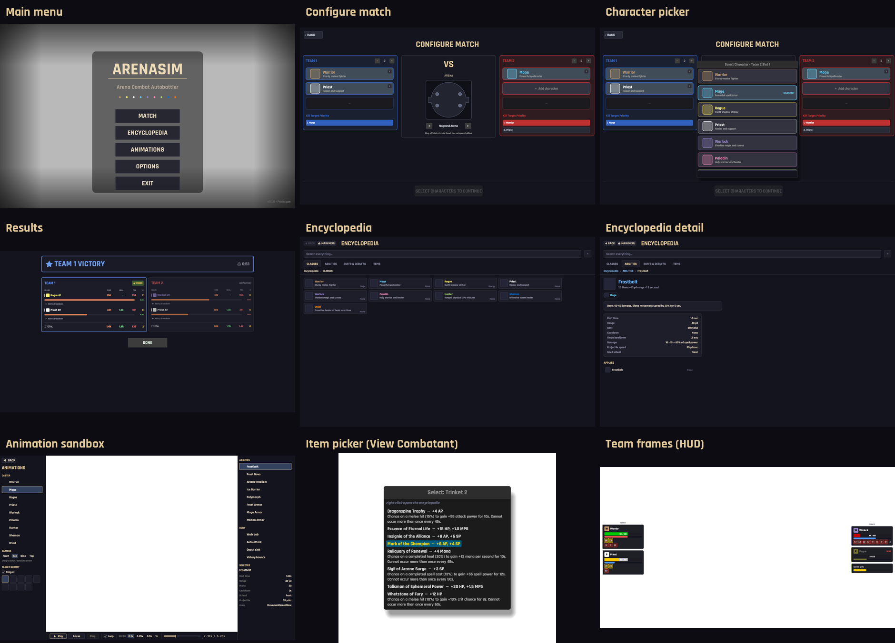
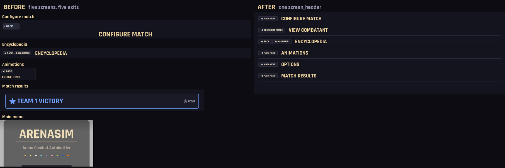
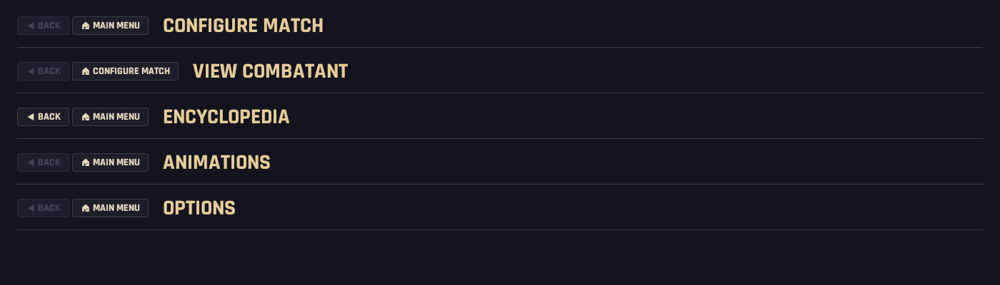
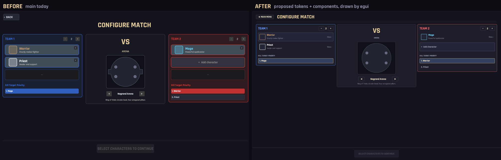
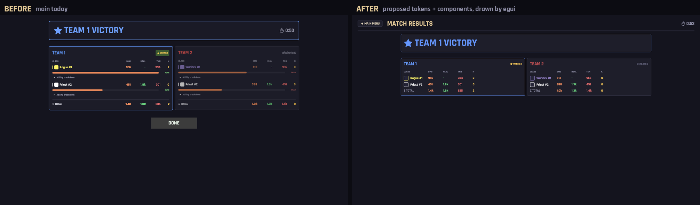
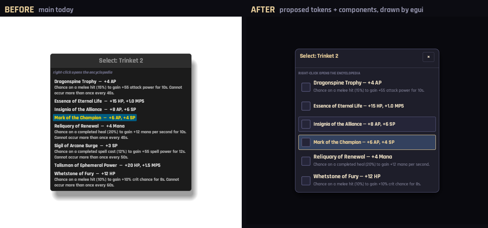
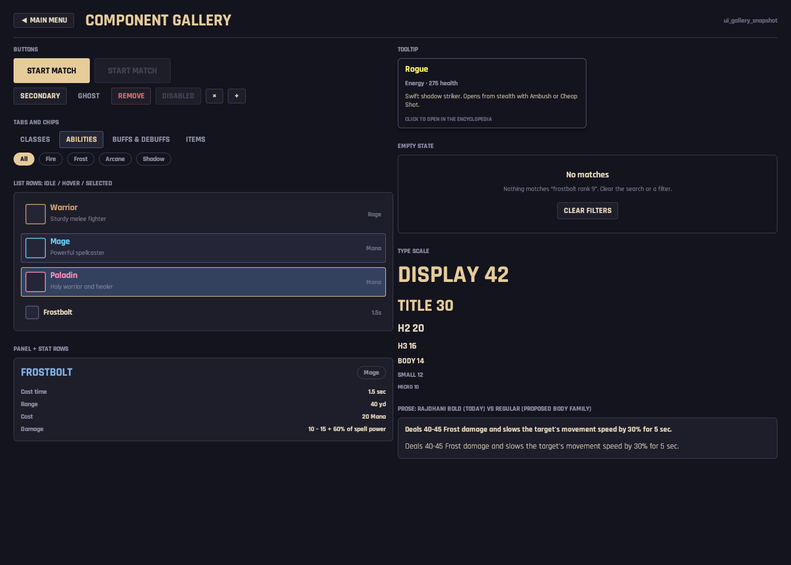

# UI design system: one look, one kit, one audit

**Status:** proposal, awaiting the decisions in [§5](#5-decisions-for-the-user). Card AS-251.
**Interactive bench:** [`docs/design/benches/2026-10-11-ui-design-system-bench.html`](../benches/2026-10-11-ui-design-system-bench.html).
It shows every proposed token and component in the client face. Its knobs emit the
`src/ui/theme.rs` constants they would become.
**Images:** [`2026-10-11-ui-design-system/`](2026-10-11-ui-design-system/).
- **BEFORE images** are the blessed snapshot baselines. They were re-rendered on `main` @
  `7905152` with every `*_snapshot` harness and came out byte-identical, so they show the
  shipped screens today.
- **AFTER images** come from a throwaway `egui_kittest` harness. It drew the proposed tokens
  and components with the client's own font stack. They are what egui renders, not a browser
  approximation.

## Summary

The screens look like they were built by different engineers because each one picks its own
look. Nothing is shared to stop it.
- **Separate palettes.** Three screens each keep a hand-copied palette. A further 377 colour
  literals are spread across 27 files.
- **Separate styles.** Seven screens each patch egui's one global, sticky `Style`, so a
  screen's widgets change with the route you took to reach it.
- **No component library.** The project already has one, but it is trapped in
  `encyclopedia/widget.rs`. View Combatant and Results borrow pieces of it, and the other
  screens rebuild their own.

The proposal:

1. **Tokens** (`src/ui/theme.rs`):
   - colour roles, split into three layers: chrome, data and HUD;
   - a 7-step type scale (today has 26 distinct literal sizes);
   - an 8-step spacing scale;
   - 3 radii;
   - 6 icon sizes.

   Chrome is the encyclopedia's gold-on-navy, which is already the most deliberate palette in
   the game.
2. **Components** (`src/ui/widgets/`): one `screen_header` with one exit model, five button
   variants, panel, list row, stat rows, tabs, chips, one tooltip builder, the linked icon,
   modal, empty state, and the resource bar.
3. **Install once.** `ui::install(ctx)` sets fonts and style once, for the client and every
   harness. It replaces the seven per-screen `set_style` calls, which ends the leaks.
4. **Drift is caught by machinery, not prose:**
   - a source audit (`tests/ui_token_audit.rs`) that ratchets raw colours, sizes and gaps
     outside `ui::theme` down to zero;
   - a compiler stop site (`GameState::chrome()`, an exhaustive match);
   - a component-gallery snapshot;
   - one CLAUDE.md rule.
5. **Migration:** 14 cards, each one independently shippable and re-blessing only its own
   baselines. Foundations come first, then screens in order of risk: Encyclopedia → Sandbox →
   Results → Configure → Main menu → View Combatant → Options/Keybindings. The HUD comes last.

---

## 1. Audit

### 1.1 What the screens look like today



*White areas are transparent in the baseline: the 3D scene (or, for the item picker, the
View Combatant sheet) draws there in the client.*

**Coverage.** Harnessed screens are rendered by `tests/{main_menu,configure_match,results_screen,
encyclopedia,animation_sandbox,item_picker,team_frames}_snapshot.rs`. Three screens have **no
pure draw function and therefore no harness**: View Combatant's sheet
(`view_combatant_ui.rs:345`, `view_combatant_ui`), Options (`states/mod.rs:1372`) and
Keybindings (`states/mod.rs:1699`). Of the HUD, only the team frames have one. Those are
audited from source below.

### 1.2 Root causes

These five structural problems produce almost every individual difference in §1.3.

**R1. Style is a sticky global that every screen patches differently.** egui keeps one `Style`
per context, and it persists between frames and between screens. Seven screens clone it,
change a few fields and call `ctx.set_style`, each changing a different set of fields:

| Screen | Fields it sets | Cite |
|---|---|---|
| Encyclopedia | every `widgets.*` state, `selection`, `extreme_bg_color`, `tooltip_delay = 0` | `encyclopedia/mod.rs:387-392`, `apply_palette :684-716` |
| Animation sandbox | most `widgets.*` (different hover stroke), `selection` (navy, not gold) | `animation_sandbox/ui.rs:157-182` |
| Results | `window_fill`, `panel_fill`, `tooltip_delay = 0` | `results_ui.rs:250-256` |
| View Combatant | `window_fill`, `panel_fill`, `tooltip_delay = 0` | `view_combatant_ui.rs:371-375` |
| Configure | `window_fill`, `panel_fill` | `configure_match_ui.rs:264-268` |
| Options / Keybindings | `window_fill`, `panel_fill` | `states/mod.rs:1385-1388`, `:1727-1730` |
| Main menu, HUD | nothing | — |

Any field a screen does not set keeps the value the previous screen left behind. Three examples:

- **Results.** DONE is a stock `egui::Button` (`results_ui.rs:329-334`). Coming from a match,
  it draws in egui's stock grey. Coming back from the encyclopedia (a result's ability links
  open it), it draws in the encyclopedia's `PANEL` fill, `LINE` stroke and gold hover.
- **Configure.** Configure *clones* the style (`configure_match_ui.rs:265`), so its ±, ◀/▶
  and Cancel buttons follow the same rule.
- **HUD.** The time-controls window and the combat log build their frames from the inherited
  style: `egui::Frame::window(&ctx.style())` at `rendering/hud.rs:169` and
  `Frame::side_top_panel(&ctx.style())` at `rendering/combat_log.rs:59`. A normal match
  arrives from Configure and inherits Configure's fills. `--replay` boots straight into
  `PlayMatch` and gets egui's defaults. So the HUD a replay shows is not the HUD a match
  shows.

The snapshot harnesses start each render from a fresh context, so **no baseline can see this
class of bug.**

**R2. Palettes are copied, not shared.** There are three hand-written palettes.
- `encyclopedia/mod.rs:87-96` is the canonical one: `BG` (20,20,30), `PANEL` (30,30,42),
  `PANEL_HI` (37,37,56), `LINE` (60,60,80), `LINE_HI` (86,86,122), `GOLD` (230,204,153), `TEXT`
  (230,217,191), `MUTED` (142,142,166), `DIM` (102,102,126) and `LINK` (127,178,229).
- `animation_sandbox/ui.rs:22-29` copies five of those values and then drifts. Its
  `MUTED_TEXT` is a neutral (102,102,102), against the encyclopedia `DIM`'s blue-shifted
  (102,102,126).
- `results_ui.rs:76-88` drifts by a few points: `PANEL_BG` (28,28,40) against `PANEL`
  (30,30,42), and `DIVIDER` (70,70,88) against `LINE` (60,60,80).

Everything else is inline: 377 `Color32::from_rgb/rgba/gray` literals across 27 files, plus 54
named `Color32::` constants. `BG` (20,20,30) alone is typed out in 7 files.

**R3. A component library exists, but only the encyclopedia owns it.**
`encyclopedia/widget.rs` already has `paint_icon`, `tooltip`, `link`/`link_with`, `tile`,
`row`, `chip`, `detail_header`, `section_heading`, `prose_block` and `stat_rows`.
- **View Combatant and Results reach into it.** View Combatant uses
  `view_combatant_ui.rs:579, 603, 1377, 2019, 1456`; Results uses `results_ui.rs:128, 722`.
- **The rest rebuild their own.** The sandbox has private duplicates (`paint_icon`, `section`,
  `icon_row`). View Combatant copy-pastes its choice-tile code four times, and redefines
  `gold`/`gray` locals in five functions (`:1746, 1953, 2101, 2282, 2438`). The Configure slot
  card and picker row are near-copies of each other (`configure_match_ui.rs:866-1065` vs
  `:529-627`).
- **`ui::UiPlugin` is empty.** `src/ui/mod.rs:18-29` describes it as a "placeholder for future
  shared UI utilities".

**R4. The font stack has one weight in practice.**
- **Regular is unreachable.** `ui/fonts.rs:41-42` puts Rajdhani Bold ahead of Rajdhani Regular
  in a single fallback chain. Bold covers every Latin glyph, so Regular never draws a
  character, and every word in the game is Bold. Long prose (encyclopedia descriptions, item
  procs, tooltips) has no lighter weight to fall back on.
- **`.strong()` does nothing.** Every call also sets `.color()`, and `.strong()` only changes
  the colour when no colour is set. Results compensates with a hand-made faux-bold double paint
  (`results_ui.rs:825-833`).
- **One HUD surface uses another font.** Overhead status labels use `FontId::monospace`
  (`rendering/hud.rs:791`), which is egui's Hack, not Rajdhani.

**R5. Exit and Esc are decided per screen.** One exhaustive `match` already exists:
`handle_escape_key`, `camera/mod.rs:42-83`. It sends Options → MainMenu, Keybindings → Options,
Results → MainMenu and Sandbox → MainMenu. It defers to private handlers for Configure, View
Combatant and the Encyclopedia. The visible buttons are decided separately, per screen, as
§1.3 shows.

### 1.3 Differences by dimension

| Dimension | What differs (selected; full detail in §1.4) |
|---|---|
| **Screen title** | **Size.** 42 on Configure/View Combatant/Options/Keybindings (`configure_match_ui.rs:310`, `view_combatant_ui.rs:526`, `states/mod.rs:1417, 1757`); 30 on Encyclopedia (`encyclopedia/mod.rs:480`); 20 on Sandbox (`animation_sandbox/ui.rs:416`); 72 pulsing on the main menu (`main_menu.rs:209`). Results has no title, only a 40pt team-coloured banner (`results_ui.rs:376`). **Position.** Centred on Configure, inline after the nav cluster on Encyclopedia, in the left panel on Sandbox. |
| **Section heading** | Sizes are 24 (Options), 28 (Keybindings), 18 (View Combatant), 20 (Configure team header), 15 (Encyclopedia `section_heading`, `widget.rs:397`), 12 (Sandbox `section()`, `ui.rs:185`). Results has none. |
| **Type sizes** | 26 distinct literal sizes across 250 sites: 9, 10, 11, 11.5, 12, 12.5, 13, 13.5, 14, 14.5, 15, 16, 18, 19, 20, 22, 24, 28, 32, 36, 40, 42, 48, 72, 96, 120. **Body text** is 13.5 (Encyclopedia), 14 (View Combatant, Results), 13 (Sandbox) or egui's default 12.5 for stock widgets on the same screens. |
| **Muted grey** | (153,153,153) Configure; (150,150,150) Options; (170,170,170) View Combatant; (142,142,166) Encyclopedia; (140,140,158) Results; (102,102,102) Sandbox/main-menu version; (90,90,90) View Combatant empties. Seven greys for one role. |
| **Accent gold** | Theme gold (230,204,153) for titles. Saturated (255,215,0) for View Combatant selection, the item picker's equipped item and item tooltip names (`items.rs:509-536`). Ambers: (255,200,100) rebinding, (255,180,100) Restore, (230,170,80) Options warning, (220,170,90) Sandbox warning. |
| **"Selected"** | **Encyclopedia:** gold fill with dark text, for chips. Its tabs are a third style: panel fill, line stroke, gold text. **Sandbox:** navy (51,65,94) fill with gold stroke and white text. **Configure chips:** team-colour fill. **Configure picker:** a brighter fill with a 2.5px class stroke. **View Combatant tiles:** a 3px (255,215,0) border. **Options:** a fill swap only. |
| **Panel frame** | **Configure:** radius 10, margin 14, stroke 1.5–2 (`configure_match_ui.rs:434-473`). **Results:** radius 6, margin 14. **Encyclopedia blocks:** radius 6, margin 16×12 (`widget.rs:417-421`). **View Combatant header:** radius 8, margin 15. **View Combatant other sections, Options, Keybindings:** stock `ui.group`, styled by whatever R1 left behind. **Sandbox:** default unframed side panels. **Main menu scrim:** radius 16. |
| **Radii** | 2, 3, 4, 5, 6, 8, 10, 14, 16. There is no scale. |
| **Spacing** | 24 distinct `add_space` literals across 182 sites: 2, 3, 4, 5, 6, 8, 10, 12, 14, 15, 16, 18, 20, 22, 24, 25, 28, 30, 40, 42, 50, 60, 100, 150. **Central-panel margin:** 15/20 (Configure), 20 (View Combatant, Options), 24 (Results), 18 (Encyclopedia). |
| **Buttons** | No shared button. **Main menu:** painted 280×60 at 28pt with a hand-painted hover ring (`main_menu.rs:284-317`). **Configure Start:** green (46,110,66), 300×54 (`configure_match_ui.rs:385-410`). **Results DONE:** stock, 200×48, 22pt. **Sandbox Play:** gold outline, 72×22. **Options toggles:** fill-swap stock buttons, 280×40. **Reset to Defaults:** no destructive styling and no confirm. **Danger:** no screen has a destructive variant. |
| **Back / exit** | Six treatments. **Configure:** painted `‹  BACK` 18pt, 96×38 (`configure_match_ui.rs:286-302`). **View Combatant, Options, Keybindings:** stock `BACK` 20pt, 80×36 (`view_combatant_ui.rs:515`, `states/mod.rs:1410, 1750`). **Encyclopedia:** `◀ BACK` + `🏠 <DESTINATION>` cluster at 14pt (`encyclopedia/mod.rs:418-477`). **Sandbox:** stock `◀  BACK` 15pt (`animation_sandbox/ui.rs:409`). **Results:** a bottom `DONE`. **Main menu:** EXIT as the last list button. |
| **Esc** | **Configure:** closes the picker, then leaves (`configure_match_ui.rs:195`). **Encyclopedia:** a full ladder (`encyclopedia/mod.rs:353`). **View Combatant:** leaves the screen even with the item picker open, so the picker's own Esc (`view_combatant_ui.rs:1659`) never runs. **Results:** Esc skips the `MatchResults` cleanup DONE performs (`camera/mod.rs:72-74` vs `results_ui.rs:222-224`). |
| **Tooltips** | **Encyclopedia, Results, View Combatant abilities:** `widget::link_with` → `on_hover_ui`, max width 320 (`widget.rs:82`). **View Combatant stats:** `show_tooltip_at_pointer` with plain labels (`view_combatant_ui.rs:946`). **Sandbox:** `on_hover_text`, at egui's 500 default and its 0.4s delay. **In-match timeline:** a hand-painted, unbounded-width label (`combat_log.rs:370-427`). **Tooltip delay:** 0 on three screens, egui's default on the rest, and leaked between them (R1). |
| **Icon sizes** | 18 (Results), 20 (team-frame auras, chips), 22 (View Combatant rows), 24 (Encyclopedia small, Sandbox rows), 28 (timeline), 36 (Encyclopedia tile), 42/48 (View Combatant choice tiles), 46 (Configure class), 54 (View Combatant header), 56 (Encyclopedia header). `rendering/mod.rs:39-41` defines an `AURA_ICON_SIZE` of 24 that nothing reads. |
| **Missing-icon fallback** | **Encyclopedia:** a panel tile with a line stroke. **Results:** a solid class-colour square. **Sandbox:** nothing at all. **Team frames:** a class square with an initial. **Timeline:** a colour square with an abbreviation, hard-coded for about 18 abilities; Shaman, Druid, Paladin and Hunter get a grey `??` (`combat_log.rs:451-502`). |
| **Empty states** | **Encyclopedia:** muted 15pt + "Clear filters" (`abilities.rs:395-410`). **Results:** a red 28pt heading (`results_ui.rs:272-278`). **View Combatant:** a red 24pt line (`:392-397`). **Configure:** a grey "—" (`:1059-1065`). **Item picker:** an empty list draws nothing. |
| **Team colours** | Three pairs. **HUD, overlays, timeline, bubbles:** (100,150,255)/(255,100,100). **Results panels:** (90,140,230)/(230,90,90) (`results_ui.rs:307, 319`). **Results banner:** (110,160,255)/(255,110,110) (`:358, 362`). Configure adds a fourth: (51,102,204)/(204,51,51) (`configure_match_ui.rs:436-442`). |
| **Class colour** | One source, `CharacterClass::color()` (`match_config.rs:347`). It has one shared converter (`results_ui::class_color32`, `:916`) and four inline re-conversions: `configure_match_ui.rs:521, 917`, `view_combatant_ui.rs:484`, `encyclopedia/topic.rs:182`. A second, deliberately distinct mesh palette exists for the 3D bodies (`play_match/mod.rs:371`). That one is correct, and stays out of the UI. |

### 1.4 Per-screen notes

- **Main menu** (`main_menu.rs:188` `draw_main_menu`).
  - It has the most polish and sets no style. Its buttons are painted by hand on purpose, to
    avoid leaking (`:282`). It is the one screen where the gold and text values are literals
    that happen to equal the encyclopedia's.
  - Its 72pt wordmark and its scrim are hero treatments, not chrome. They stay as a template of
    their own (§2.4).
- **Configure match** (`configure_match_ui.rs:256` `draw_configure_match`).
  - The densest set of one-offs: painted slot cards, painted kill-target chips, a green CTA,
    four team-colour literals, and two inline class-colour conversions.
  - The character picker is a stock `egui::Window` with a Cancel button but no close ×. The
    item picker has the opposite: a close × but no Cancel.
- **View Combatant** (`view_combatant_ui.rs:345`; 2,677 lines).
  - It has no draw/wrapper split, so it has no harness.
  - It uses stock `ui.group` for every section, so its look is whatever R1 left.
  - It has the second gold (255,215,0), five local `gold`/`gray` definitions, and four
    copy-pasted choice-tile implementations.
  - It has the Esc defect above.
- **Options / Keybindings** (`states/mod.rs:1372`, `:1699`).
  - All literals; no harness.
  - Toggle buttons show selection by fill swap only.
  - Reset to Defaults has no confirm.
  - A key conflict is only logged (`:1955`).
- **Encyclopedia** (`encyclopedia/`; 6,800 lines).
  - The most deliberate screen, and the source of the proposed chrome tokens and most of the
    components.
  - Its own inconsistency: body text at 13.5 next to stock widgets at egui's 12.5.
- **Results** (`results_ui.rs:244` `draw_results_screen`).
  - A well-structured stats table, but on a near-copy palette with no title.
  - Its banner `heading` is 40pt.
  - Its column headers and ALIVE/DEAD labels are 9–10pt, the smallest menu text in the game.
- **Animation sandbox** (`animation_sandbox/ui.rs`).
  - A tool screen with a different selection language (navy), a gold hover stroke where the
    encyclopedia uses `LINE_HI`, and Debug class names with no class colour.
  - It is still a player-reachable screen from the main menu, so it is in scope.
- **In-match HUD** (`play_match/rendering/`).
  - **Team frames** are the most disciplined surface: named `CALL_*` constants
    (`team_frames.rs:152-161`) and one resource-colour table (`:796-811`).
  - **The panels disagree.** Time controls, combat log and camera window use pure black at
    alpha 200, 180 and 150; the team frames use (13,13,20,235).
  - **Bar backgrounds** come in seven different near-blacks.
  - **Status labels** are white, as the colour-budget rule requires, but in monospace Hack.
  - **Floating combat text** colours are about 29 inline literals at spawn sites, not a table.
    Holy Shock's heal is (0,255,0) while every other heal is (100,255,100) (`effects/holy_shock.rs:80`).
  - **Banter bubbles** paint colour emoji as **image textures** (`emoji.rs`). That is the
    correct workaround for egui's single-channel atlas, not a violation.

### 1.5 Defects found on the way (suggested cards, not in this proposal)

1. View Combatant: Esc leaves the screen with the item picker open; the picker's own Esc
   handler is dead (`view_combatant_ui.rs:378-383` returns before `:1659`).
2. Results: Esc skips `remove_resource::<MatchResults>()` (`camera/mod.rs:72-74`).
3. Timeline fallback icons are hard-coded for about 18 abilities. Newer classes draw a grey
   `??` (`combat_log.rs:451-502`).
4. Dead code: `AURA_ICON_SIZE` and `AURA_ICON_SPACING` (`rendering/mod.rs:39-41`), the unread
   second resource colour (`team_frames.rs:597`), and a stale doc comment (`hud.rs:324-330`).

---

## 2. Proposed design system

### 2.1 Principles

1. **One place per decision.** A colour, size or gap is chosen once, in `ui::theme`, and named
   by its *role*, never its look. `TEXT_MUTED`, not `GREY_142`.
2. **Three layers, three budgets.**
   - **Chrome** (menus, panels, buttons): gold on navy, few hues.
   - **Data** (class, team, school, damage/heal/taken): hue carries meaning.
   - **HUD** (in-match): its own broadcast rules. Labels stay white, and the FCT reserves
     yellow, green and light-blue (project rule: colour budget).

   A token belongs to exactly one layer, and the layers do not borrow from each other.
3. **Text carries meaning; colour is a second channel at most.** No new status gets a
   colour of its own.
4. **Bold is the voice, not the default.** Titles, labels, numbers and buttons stay Rajdhani
   Bold. Long prose gets Rajdhani Regular through a named `Body` family (decision D3).
5. **Icons are judged by luminance, at size, on their real ground** (project rule:
   small-icon legibility). The icon scale fixes the sizes. A new icon is compared against the
   shipped set's median contrast at the size it will be drawn.

### 2.2 Tokens

All values below are proposals. They live in the bench as knobs.

**Colour: chrome and text** (the encyclopedia's palette, renamed by role)

| Token | RGB | Role | Replaces |
|---|---|---|---|
| `BG` | 20,20,30 | screen background | 7 copies of (20,20,30) |
| `PANEL` | 30,30,42 | panel, button fill | `PANEL`, `TILE_BG`, `PANEL_BG` (28,28,40), banner (26,26,38) |
| `RAISED` | 37,37,56 | hover, active tab | `PANEL_HI`, sandbox hover (42,42,58) |
| `LINE` | 60,60,80 | panel stroke, divider | `LINE`, `TILE_FRAME`, `DIVIDER` (70,70,88), (55,55,70) |
| `LINE_STRONG` | 86,86,122 | hover stroke, tooltip/modal edge | `LINE_HI` |
| `SELECTED` | 51,65,94 | current row in a list | sandbox `SELECTED_BG` |
| `ACCENT` | 230,204,153 | titles, active, primary | `GOLD`, `TITLE_GOLD`, (255,215,0) in menus |
| `TEXT` | 230,217,191 | body | `TEXT`, `BUTTON_TEXT`, (220,220,220), (230,230,230), (200,200,200) |
| `TEXT_MUTED` | 142,142,166 | labels, secondary | the seven greys in §1.3 |
| `TEXT_DIM` | 102,102,126 | disabled, hints | `DIM`, `MUTED_TEXT` (102,102,102), (90,90,90) |
| `LINK` | 127,178,229 | navigable names | `LINK` |
| `WARN` | 220,170,90 | warnings | four ambers |
| `DANGER` | 205,110,110 | destructive, dead | `C_DEAD`, (200,100,100), (200,80,80) |

**Colour: data** (meaning-bearing; one table each)

| Token | RGB | Replaces |
|---|---|---|
| `TEAM_1` / `TEAM_2` | 100,150,255 / 255,100,100 | 4 pairs (§1.3). This is the HUD pair, the one used in the most places. Fills derive from it by alpha. |
| `DAMAGE` / `HEALING` / `TAKEN` / `KILLS` | 255,150,100 / 110,215,130 / 230,110,110 / 255,205,90 | `results_ui.rs:80-83` |
| `BUFF` / `DEBUFF` | 111,174,126 / 208,106,91 | `encyclopedia/auras.rs:87-88`; team-frame gold/red borders |
| class | `CharacterClass::color()`, unchanged | 4 inline converters → one `theme::class_color(class)` |
| school | `encyclopedia/abilities.rs:357` `school_color`, moved to `theme::school_color` unchanged | — |

**Colour: HUD** (`theme::hud`, in-match only)

- **`HUD_PANEL`:** one translucent fill, replacing alpha 150, 180, 200 and (13,13,20,235).
- **`HUD_GOLD`:** (255,215,0), used for the countdown, Victory and buff borders.
- **`HUD_LABEL`:** white.
- **`BAR_TRACK`:** one near-black, replacing seven.
- **Health thresholds and resource colours:** the existing team-frame table, promoted to
  tokens.
- **`fct::{DAMAGE, AUTO, HEAL, ABSORB, IMMUNE, …}`:** one table replacing about 29 spawn-site
  literals. It makes Holy Shock's heal (0,255,0) agree with every other heal.

The FCT reservation (yellow, green, light-blue) becomes checkable here. The table is the
only place those hues are written, and the audit (§3.4) enforces that.

**Type scale** (Rajdhani Bold unless noted)

| Token | pt | Use | Absorbs |
|---|---|---|---|
| `WORDMARK` | 72 | main-menu logo only | 72 |
| `DISPLAY` | 42 | VS, victory banner | 40, 42, 48 |
| `TITLE` | 30 | screen title | 20, 24, 28, 30, 42 (titles) |
| `H2` | 20 | panel title | 18, 19, 20, 22, 24 |
| `H3` | 16 | section, row title | 14.5, 15, 16 |
| `BODY` | 14 | body, buttons | 12.5, 13, 13.5, 14 |
| `SMALL` | 12 | labels, stat rows | 11, 11.5, 12 |
| `MICRO` | 10 | column headers, badges | 9, 10 |

The HUD scales its own sizes by zoom (`hud.rs` `ui_scale`). It uses the same steps multiplied
by that factor. The 96/120pt overlay countdown digits stay HUD-local.

**Spacing:** `XXS 2 · XS 4 · SM 8 · MD 12 · LG 16 · XL 24 · XXL 32 · XXXL 48`. This replaces 24
distinct literals. The screen margin is `XL` horizontally and `LG` vertically on every screen.

**Radius:** `SM 3` for chips, rows and icons; `MD 6` for panels, buttons and tooltips; `LG 10`
for modals and team columns. This replaces nine values.

**Icon size:** `XS 16 · SM 20 · MD 24 · LG 36 · XL 48 · HERO 56`. Mapping:
- Results 18 → `SM`.
- View Combatant rows 22 → `MD`.
- Timeline 28 → `MD`.
- Configure 46 and View Combatant 54 → `XL` and `HERO`.
- Team-frame auras stay `SM`.

### 2.3 Components

Every component reads only tokens, takes an optional `ui_driver` id (so `--ui-script` marks
come with it), and has a row in the gallery harness.

| Component | Shape | Replaces |
|---|---|---|
| `screen_header(ui, title, nav, trailing)` | nav cluster, then the title at `TITLE` in `ACCENT`, then a trailing slot, then a `LINE` rule | six back/exit treatments (§1.3) |
| `Nav` | `Nav::Exit(dest)` draws `◀ DEST`. `Nav::Stacked { can_back, dest }` draws `◀ BACK` + `🏠 DEST`, with Back disabled (never hidden) at the root. Esc runs the same ladder: close modal → clear search → back → exit. | `chrome_button`, five BACK buttons, R5's split Esc logic |
| `button(ui, label, Variant)` | `Primary` (gold fill, dark text, one per screen, 44 tall), `Secondary`, `Ghost`, `Danger`, `Icon`. Disabled is a state of each variant. | menu buttons, green Start, DONE, Play, toggles, Reset |
| `panel(accent)` | `PANEL` fill, 1px `LINE` (or the accent colour), `MD` radius, `MD` margin | `ui.group`, 5 hand-built frames |
| `panel_header(ui, title, colour, trailing)` | `H2` title + trailing controls | team headers, section headings |
| `list_row(...)` | icon, name (`H3`/`BODY`), optional sub-line, right-aligned meta. Idle, hover (`RAISED` + `LINE_STRONG`) and selected (`SELECTED` + `ACCENT` stroke). | Configure slot cards and picker rows, item picker, sandbox `icon_row`, encyclopedia `row`/`tile` |
| `stat_rows(ui, rows)` | key `SMALL` `TEXT_MUTED`, value right-aligned `TEXT` | encyclopedia `stat_rows`, View Combatant grids, sandbox details |
| `tabs` / `chip` | tabs: `RAISED` fill when active. Chips: a pill, gold fill when on. These are the two "on" languages, each with one job. | encyclopedia tabs/chips, sandbox speed/camera labels, Options toggles |
| `tooltip(ui, …)` | one builder: `BG` fill, `LINE_STRONG` edge, `MD` radius, max width 320, `H3` title + `SMALL` meta + Body text + `MICRO` hint. One delay, set once. | 4 tooltip mechanisms |
| `linked_icon` | the existing `widget::link`/`link_with`, moved unchanged | — |
| `modal(ctx, title, …)` | scrim, `PANEL` window, `LG` radius, title + close ×. Esc closes it. Optional footer for Cancel/Confirm. | both stock pickers |
| `empty_state(ui, title, body, action)` | outlined panel, `H3` + Body, optional secondary action | five ad-hoc empties |
| `resource_bar` / `class_icon` | one bar and one icon-with-fallback (`RAISED` tile + class-colour stroke), sized by token | bar and fallback variants |

### 2.4 Screen templates

| Template | Shape | Screens |
|---|---|---|
| **Hero** | full-bleed scene, centred card, wordmark, a vertical menu of `Primary`-sized buttons | Main menu |
| **Document** | `screen_header`, then optional tabs and a search row, then a scrolling body at a max width | Encyclopedia, View Combatant, Options, Keybindings |
| **Setup** | `screen_header`, then N columns of `panel`s, then a docked footer with one `Primary` | Configure Match |
| **Report** | `screen_header` (trailing slot: duration), then a `DISPLAY` banner panel, then data panels | Results |
| **Workbench** | `screen_header`, then left and right side panels, then a bottom transport | Animation sandbox |
| **HUD** | anchored `Area`s on `HUD_PANEL`, no header, HUD tokens | in-match |

### 2.5 Before and after

These are drawn by egui with the proposed tokens. The mockups show each screen's shell
(header, panels, rows, type, colour), not every widget on it.

**Every screen's header and exit, today and proposed.** Flat screens get one named exit;
only the encyclopedia, which has history, gets the Back + Home pair.



The alternative is the encyclopedia's pair on every screen, with Back disabled where there is
no history. That keeps the title in one x-position on every screen, at the cost of a dead
button on five of them (decision D2):



**Configure Match.** Same layout. The slot cards and picker rows become one `list_row`; the
kill-target chips become selected rows; the green CTA becomes the one `Primary`; the team
colours become the HUD pair.



**Results.** A title and an exit like every other screen. The duration moves to the header's
trailing slot. DONE goes away, because `◀ MAIN MENU` does the same thing and Esc now takes the
same path (decision D4).



**Item picker** (View Combatant). The stock grey `egui::Window`, its default-blue selection
and its leaked style become the `modal` component.



**The component gallery.** This image is also the proposed `tests/ui_gallery_snapshot.rs`
baseline. The last row compares today's all-Bold prose with Rajdhani Regular through the
proposed `Body` family (decision D3).



---

## 3. Framework that keeps additions consistent

### 3.1 Where things live

```
src/ui/
  mod.rs        pub fn install(ctx)  — fonts + theme, the ONE call (client Startup + every harness)
  fonts.rs      unchanged, plus a named `Body` family (D3)
  theme.rs      tokens: color, text, space, radius, icon, hud, fct; class_color(); school_color();
                fn style() -> egui::Style   — the complete Visuals/Spacing/tooltip settings
  widgets/      button.rs header.rs panel.rs list_row.rs stat_rows.rs tabs.rs tooltip.rs
                link.rs (moved from encyclopedia/widget.rs) modal.rs empty_state.rs bars.rs
  layout.rs     the five menu templates as fns: document(ctx, header, body), setup(...), ...
  driver/       unchanged
```

`encyclopedia/widget.rs` keeps only what is encyclopedia-specific: `Topic`-aware tiles and
detail headers, built from `ui::widgets`.

### 3.2 Install once

`ui::install(ctx)` sets the fonts and the whole `Style` once, at startup. Every
`ctx.set_style` and `style_mut` outside `src/ui/` is deleted. That deletion fixes R1 by
construction: there is nothing left to leak.

A screen that genuinely needs a local variation uses `ui.scope(|ui| { ui.style_mut()… })`,
which egui restores on exit. That is the only sanctioned form.

`tests/snapshot_font_audit.rs` already enforces that every harness calls
`install_game_fonts`. It is re-pointed at `ui::install`, so a harness cannot render a theme the
client does not run.

### 3.3 Building a new screen

```rust
pub fn draw_ladder(ctx: &egui::Context, data: &LadderData) -> Option<LadderAction> {
    let mut action = None;
    ui::layout::document(ctx, ui::Header::new("Ladder", Nav::Exit(GameState::MainMenu)), |ui| {
        ui::widgets::panel(None).show(ui, |ui| {
            ui::widgets::panel_header(ui, "Season 1", theme::color::ACCENT, |_| {});
            for row in &data.rows {
                if ui::widgets::list_row(ui, ListRow::new(&row.name).meta(&row.rating)).clicked() {
                    action = Some(LadderAction::Open(row.id));
                }
            }
        });
    });
    action
}
```

Four steps:

1. Split the screen into a pure `draw_*` plus a Bevy wrapper. This is the existing rule.
2. Pick a template.
3. Compose widgets.
4. Answer the two compiler questions in §3.4b.

A screen that needs a new component adds it to `ui::widgets` and to the gallery in the same
commit. A screen never draws a one-off.

### 3.4 How drift is caught

This repo prefers stop sites and audits over prose. Four mechanisms, each with its own job:

**a. Source audit: `tests/ui_token_audit.rs`** (default `cargo test`, no GPU)
- **What it flags.** It scans `src/` outside `src/ui/theme.rs` for:
  - raw colour: `Color32::from_rgb|from_rgba_*|from_gray|from_black_alpha|from_white_alpha`
    and named `Color32::` constants other than `TRANSPARENT`;
  - literal type sizes: `.size(<number>)` and `FontId::*(<number>)`;
  - literal gaps: `add_space(<number>)`, and literal `Margin`/`corner_radius`/`vec2` spacing
    arguments;
  - `set_style`, `set_visuals` and `style_mut` outside a `ui.scope`.
- **It ratchets with EQUALITY, not a floor.** A per-file table records today's count, and the
  test fails if a file's count goes up *or down* without the table moving with it. So the
  migration tightens the ratchet card by card, and slack cannot hide (the
  `ge-floors-hide-vacuous-assertions` lesson). The last migration card empties the table.
- **It plants its own offender.** A self-test runs the scanner over a fixture string that
  contains each pattern once and asserts every one is caught, so a broken regex cannot go
  vacuous.
- **Scope.** World-space effect colours are Bevy `Color`, not egui `Color32`, so they are
  out of scope by type. The data and HUD tables are in `theme.rs`, so they are not offenders.

**b. Compiler stop site: `GameState::chrome()`**

```rust
impl GameState {
    /// Every screen answers: which template, and where its exit goes.
    /// Exhaustive, no wildcard — a new state does not compile until it answers.
    pub fn chrome(self) -> Chrome {
        match self {
            GameState::MainMenu => Chrome::hero(),
            GameState::Encyclopedia => Chrome::document(Nav::Stacked),
            GameState::ViewCombatant => Chrome::document(Nav::Exit(GameState::ConfigureMatch)),
            GameState::PlayMatch => Chrome::hud(),
            // ...
        }
    }
    /// The snapshot harness that pins this screen, or the reason it has none.
    pub fn harness(self) -> ScreenHarness { /* exhaustive */ }
}
```

- **One rule for Esc.** `handle_escape_key` (`camera/mod.rs:42`) already is an exhaustive
  match. It is replaced by one rule that reads `chrome().nav`, so Esc and the visible exit
  cannot disagree.
- **`harness()` is a decision, not a list.** A new screen has to name its harness file or
  state why it has none. A default test checks that each named file exists. This follows the
  `a-macro-generates-a-list-not-a-decision` rule: membership is a judgement, so the compiler
  asks.

**c. Component gallery: `tests/ui_gallery_snapshot.rs`** (`#[ignore]`, like the rest)
- **What it draws.** Every component in every state, on one page (the image in §2.5).
- **Why it exists.** A token change is then visible in one PNG rather than scattered across
  41 baselines. The snapshot rule already in CLAUDE.md applies: bless in the same commit, and
  read the `.new.png` first.
- **What it does not add.** No new CI step, and no snapshot process beyond what the repo
  already has.

**d. One CLAUDE.md rule** (in *Iterate on an egui screen*), proposed text:

> **UI values come from `ui::theme`, UI pieces from `ui::widgets`.** A colour, text size, gap,
> radius or icon size written as a literal anywhere else fails `tests/ui_token_audit.rs`; a
> new screen does not compile until `GameState::chrome()` and `harness()` answer for it. Need
> something the kit lacks? Add the token or widget, and its gallery row, in the same commit.

---

## 4. Migration plan

Each card ships alone, re-blesses only the baselines it names, and lowers the audit table for
the files it touches. Sizes: S ≈ half a day, M ≈ a day, L ≈ two or more days.

| # | Card | Scope | Re-blesses | Size |
|---|---|---|---|---|
| 1 | **Foundations** | `ui::theme` tokens, `ui::install`; `snapshot_font_audit` → `install`; `ui_token_audit` with today's counts frozen; the CLAUDE.md rule. `install` sets fonts only, so this card changes no pixels. | none | M |
| 2 | **Widget kit + gallery** | `ui::widgets`: button, header/Nav, panel, list_row, stat_rows, tabs, chip, tooltip, modal, empty_state, bars. Move `encyclopedia/widget.rs` link/tooltip pieces (re-exported from the old path). Add `ui_gallery_snapshot`. | new gallery baseline | L |
| 3 | **Global style + `GameState::chrome()`** | `install` sets the full `Style`. Delete the 7 `set_style` sites. Add `chrome()`/`harness()`. Esc derives from `Nav`, fixing the two Esc defects in §1.5. | every menu baseline, because the stock widgets change | M |
| 4 | **Encyclopedia** | Swap its local consts for tokens; `screen_header`; its widgets now come from `ui::widgets`. Smallest visual change, since it is the source palette. | 30 encyclopedia PNGs | M |
| 5 | **Animation sandbox** | Workbench template; selection and hover move to the shared states. | 2 | S |
| 6 | **Results** | Report template, header + exit, DONE removed (D4), tokens for the data colours. | 4 | M |
| 7 | **Configure Match** | Setup template; slot card and picker → `list_row`; picker → `modal`; Primary CTA; team tokens. | 2 | M |
| 8 | **Main menu** | Hero template; buttons through `button` (hover ring kept as a Hero variant). | 1 | S |
| 9 | **View Combatant: split** | Extract `draw_view_combatant` + wrapper; new harness; no visual change. | new baseline | M |
| 10 | **View Combatant: migrate** | Document template; the four choice tiles → one widget; item picker → `modal`. | 2 | L |
| 11 | **Options + Keybindings** | Split, harness and migrate together (small screens). Toggles → chips; Reset → `Danger` + confirm modal. | new baselines | M |
| 12 | **HUD tokens** | `theme::hud` + `fct` tables; replace about 29 FCT spawn literals; one `HUD_PANEL`; status labels to Rajdhani. | team_frames ×2 | M |
| 13 | **HUD components** | Timeline tooltip → `tooltip`; fallback icon → `class_icon`/`paint_icon`; Time Controls and camera window → `HUD_PANEL` frames. | team_frames ×2 | M |
| 14 | **Close the ratchet** | Audit table empty; remove the per-file allowance mechanism; delete the dead constants (§1.5 item 4). | none | S |

**Totals:** 14 cards. Roughly 2 S, 9 M and 3 L, about 15–18 engineer-days at this
repo's pace.

**Order.**
- **Cards 1–3 are strictly sequential.** 3 is the only card with a broad re-bless, and it is
  also the one that fixes the cross-screen leak.
- **4–8 and 9–11 can then run in parallel.** They touch disjoint files.
- **12–13 can start any time after 2.**

A milestone review can take 1–3 as one unit ("the kit"), and each later screen as its own.

---

## 5. Decisions for the user

- **D1. Base palette.** Recommended: adopt the encyclopedia's gold-on-navy for all chrome
  (the bench and every AFTER image). The alternative is to keep per-screen character. That
  would leave the problem the card names unsolved.
- **D2. Exit affordance.** Recommended: on flat screens, one named exit (`◀ MAIN MENU`); on
  the encyclopedia only, `◀ BACK` + `🏠 DEST`. The alternative is the pair everywhere, with
  Back disabled at the root (image in §2.5).
- **D3. A lighter weight for prose.** Recommended: add Rajdhani Regular as a named `Body`
  family for multi-sentence prose (descriptions, procs, tooltip bodies), keeping Bold for
  everything else. The gallery's last row compares the two. The alternative is all-Bold, as
  today.
- **D4. Results' exit.** Recommended: the header's `◀ MAIN MENU`, with the bottom DONE
  removed. The alternative keeps DONE as the screen's Primary, with no header exit.
- **D5. Primary button.** Recommended: gold fill, dark text, one per screen. This retires
  Configure's green Start. The alternative is a gold outline (the sandbox's Play).
- **D6. HUD scope.** Recommended: the HUD adopts the type, spacing, radius and tooltip tokens
  and its own `hud`/`fct` colour tables, but **not** the menu chrome palette. The broadcast
  look and the colour-budget rules stay as they are.
- **D7. Team colours.** Recommended: the HUD's (100,150,255)/(255,100,100) everywhere. These
  are the values players see most, since they are the ones the match itself uses.

**Human testing:** judge the before/after images in §2.5 and the bench. Do the AFTER screens
read as one game? Is gold-filled Primary (D5) right for Start? Is Regular prose (D3) legible
at 12–14pt on navy?
